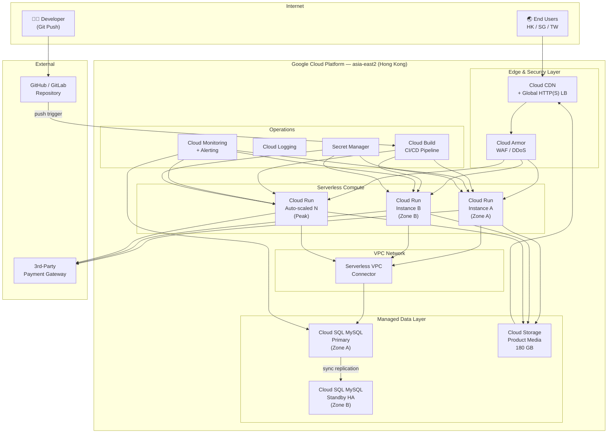
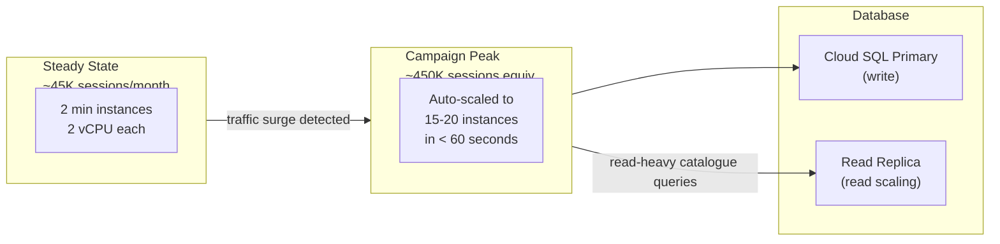
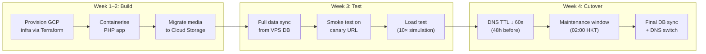
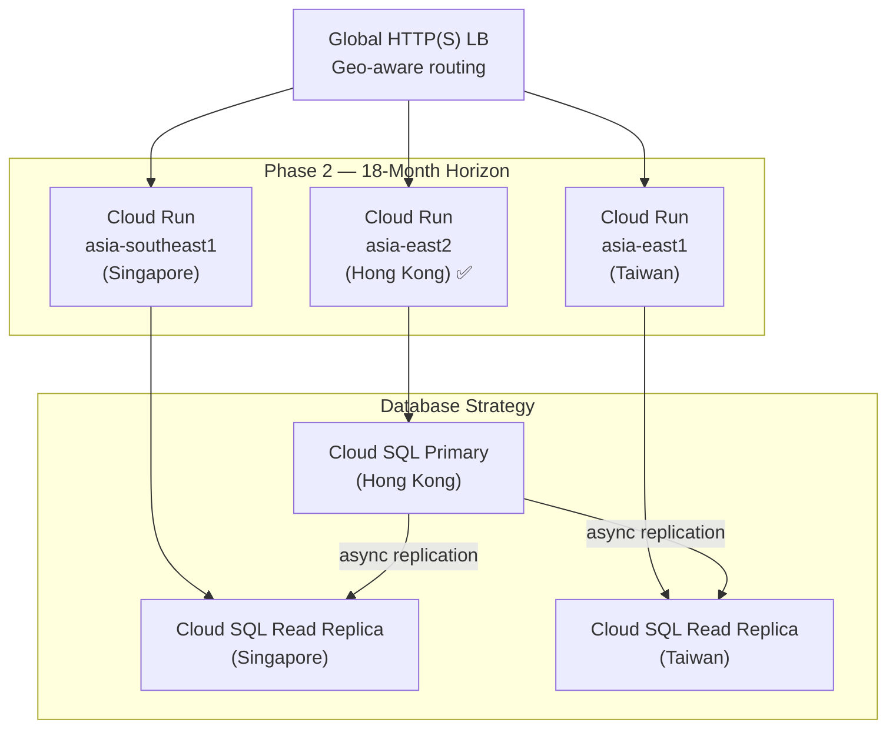

# Northpoint Living — Cloud Migration Submission Package
## IT Manager (Infrastructure, DevOps & Security) — Visible One Limited

---

> [!NOTE]
> **Candidate Assumptions Stated Up Front**
> - The PHP e-commerce platform is assumed to be **WooCommerce on WordPress** (the most common open-source PHP CMS e-commerce stack). The design works for Magento, OpenCart, or PrestaShop with minor container adjustments.
> - "Closest available region" for data residency is interpreted as **Google Cloud `asia-east2` (Hong Kong)**.
> - All prices use **public GCP pricing** as of October 2026. 1 USD ≈ 7.80 HKD.
> - The team operating this platform is **small** (2–3 engineers at Visible One), so operational simplicity is weighted heavily.

---

## A. Architecture Diagram (Deliverable A)



### Key Points on the Diagram

| Layer | Component | Purpose |
|-------|-----------|---------|
| **Edge** | Cloud CDN + Global LB | Caches static assets & media globally; single anycast IP |
| **Security** | Cloud Armor | WAF rules, geo-blocking, rate limiting, DDoS protection |
| **Compute** | Cloud Run (multi-zone) | Serverless containers — **zero servers to manage**, auto-scales 0→N |
| **Database** | Cloud SQL MySQL HA | Managed MySQL with synchronous replication across two zones |
| **Media** | Cloud Storage | Object store for 180 GB product images, served via CDN |
| **CI/CD** | Cloud Build | Git-push → build container → deploy, with rollback |
| **Secrets** | Secret Manager | DB credentials, API keys — never in code or env files |
| **Observability** | Cloud Monitoring + Logging | Dashboards, uptime checks, PagerDuty/email alerts |

---

## B. Design Rationale (Deliverable B)

### Why Google Cloud Platform?

| Decision Factor | GCP Advantage |
|----------------|---------------|
| **Hong Kong data residency** | `asia-east2` is a full GCP region **located in Hong Kong** — customer PII never leaves the jurisdiction |
| **No servers to manage** | Cloud Run is fully serverless: no VMs, no patching, no OS management |
| **10× auto-scaling** | Cloud Run scales from min instances to hundreds in seconds, per-request billing |
| **Small team friendly** | Fewer moving parts than EKS/ECS; managed database eliminates DBA burden |
| **Regional expansion** | Cloud Run + Cloud SQL can be deployed to `asia-southeast1` (Singapore) and `asia-east1` (Taiwan) using identical Terraform modules |
| **Budget fit** | Pay-per-use compute + committed-use DB discounts keep steady state well under HKD 18,000 |

### How we meet 99.9% availability

1. **Multi-zone Cloud Run** — instances run in at least two availability zones within `asia-east2`. If one zone fails, the load balancer routes to surviving instances automatically.
2. **Cloud SQL HA** — synchronous replication to a standby in a different zone. Automatic failover in < 60 seconds, transparent to the application via the Cloud SQL proxy sidecar.
3. **Cloud CDN** — even if compute is briefly degraded, cached product pages and media continue serving from the CDN edge.
4. **Health checks** — the Global HTTP(S) Load Balancer runs health checks every 10 seconds. Unhealthy instances are drained within 30 seconds.

**Where it can still fail:**
- A full regional outage of `asia-east2` (extremely rare but possible). Mitigation: the CDN continues serving cached pages; database point-in-time recovery to another region is a manual DR procedure. A cross-region active-active setup was considered but rejected for Phase 1 due to cost and complexity — this is a Phase 2 item.
- A bad deployment breaking the application. Mitigation: Cloud Run traffic splitting + instant rollback (see Deliverable D).

### How the database survives losing a node (RPO ≤ 15 min)

| Protection Layer | RPO Achieved | How |
|-----------------|-------------|-----|
| **HA synchronous replication** | **0 minutes** | Standby has every committed transaction. Failover promotes standby automatically |
| **Automated backups** | **≤ 15 min** | Cloud SQL automated backups run continuously with point-in-time recovery (PITR) using binary log. Recovery to any second within the retention window |
| **Cross-region backup** | **≤ 24 hours** | Daily backup exported to a Cloud Storage bucket in `asia-southeast1`. Protects against regional disaster |

Even if both HA nodes are somehow lost (regional failure), PITR from the most recent binary log guarantees < 15 minutes of data loss.

### How the 10× campaign spike is absorbed



- **Cloud Run auto-scaling** responds to concurrent request count. From 2 min instances to 20 takes approximately **15–30 seconds** — well within the "gradual ramp" pattern of a campaign launch.
- **Configuration:** `max-instances=50` (hard cap to prevent runaway cost), `concurrency=80` (PHP-FPM processes per container).
- **Read replica** is added to Cloud SQL during the campaign window to offload catalogue browsing queries. This is a scheduled operation (Terraform variable toggle), not a panic response.
- **CDN warm-up** — before each campaign, we cache-prime product listing pages and media so the CDN absorbs the majority of read traffic, reducing origin load by ~70%.

### What is deliberately left out of Phase 1

| Deferred Item | Reason |
|--------------|--------|
| **Cross-region active-active DR** | Doubles database cost and adds operational complexity. The single-region HA design meets 99.9%. Evaluate in Phase 2 alongside Singapore/Taiwan expansion |
| **Kubernetes (GKE)** | Overkill for a single PHP application. Cloud Run gives the same container-based workflow without cluster management |
| **Redis / Memcached cache layer** | PHP object caching (WP Redis plugin) is valuable but not critical for Phase 1 traffic. Add when optimizing P95 latency for Singapore/Taiwan users |
| **Full WAF rule tuning** | Deploy Cloud Armor with OWASP ModSecurity Core Rule Set preset. Fine-tune after 30 days of traffic baseline |
| **Multi-region media replication** | 180 GB in one region, served globally via CDN. Replicate to SG/TW buckets only when those storefronts launch |

---

## C. Cost Estimate (Deliverable C)

> [!IMPORTANT]
> All prices in **USD/month** from GCP public pricing (asia-east2). HKD conversion at 7.80. Committed-use discounts (1-year) applied where noted.

### Steady-State Monthly Cost

| Component | Specification | USD/month | Notes |
|-----------|--------------|-----------|-------|
| **Cloud Run** | 2 min instances, 2 vCPU / 4 GB each, always-allocated CPU | \$280 | Handles 45K sessions; includes request + egress fees |
| **Cloud SQL MySQL HA** | `db-custom-4-15360` (4 vCPU, 15 GB RAM), HA failover, 100 GB SSD | \$520 | 1-year committed use discount applied (~30% off) |
| **Cloud SQL Backups** | Automated PITR + daily export to GCS | \$25 | 7-day PITR retention + 30-day GCS exports |
| **Cloud Storage** | 180 GB Standard, ~50K operations/month | \$8 | Product media |
| **Cloud CDN** | ~200 GB egress/month, cache fills | \$35 | Caches media + static assets |
| **Global HTTP(S) LB** | 1 forwarding rule, 5 URL map rules | \$25 | Includes health checks |
| **Cloud Armor** | 1 security policy, 10 rules | \$12 | OWASP CRS + geo rules |
| **Cloud Monitoring** | Uptime checks, dashboards, alerting | \$15 | Well within free tier for most metrics |
| **Cloud Build** | ~20 builds/month, <10 min each | \$0 | Free tier: 120 min/day |
| **Secret Manager** | 10 secrets, ~10K accesses/month | \$1 | Negligible |
| **Serverless VPC Connector** | `e2-micro` instances (min 2) | \$15 | Connects Cloud Run → Cloud SQL private IP |
| **Misc (DNS, logs)** | Cloud DNS zone, log storage | \$10 | |
| | | | |
| **TOTAL STEADY STATE** | | **\$946** | **≈ HKD 7,380** |

### Campaign-Month Cost (2 months/year)

| Additional Component | Specification | USD/month | Notes |
|---------------------|--------------|-----------|-------|
| **Cloud Run scale-up** | Peak: 15–20 instances for 4–6 hours, twice per campaign month | +\$120 | Pay-per-use during spike only |
| **Cloud SQL Read Replica** | 1 read replica, active 2 weeks around campaign | +\$180 | Offloads catalogue reads |
| **CDN increased egress** | ~800 GB egress during campaign | +\$60 | 4× normal traffic cached |
| **Cloud Armor** | Higher request volume | +\$5 | Per-request charges |
| | | | |
| **CAMPAIGN MONTH TOTAL** | | **\$1,311** | **≈ HKD 10,225** |

### Budget Summary

| Period | Monthly Cost (HKD) | vs Target (HKD 18,000) | Status |
|--------|-------------------|----------------------|--------|
| Steady state (10 months/year) | **7,380** | 59% under budget | ✅ Well within |
| Campaign month (2 months/year) | **10,225** | 43% under budget | ✅ Within budget |
| **Annualised average** | **7,854** | **56% under budget** | ✅ |

> [!TIP]
> The significant budget headroom (~\$600/month) is deliberately preserved as a buffer for the Phase 2 Singapore/Taiwan expansion, where multi-region database replication and additional Cloud Run deployments will increase costs.

---

## D. Automation (Deliverable D)

### D1. Infrastructure-as-Code Excerpt — Cloud Run Service (Terraform)

This shows the **Cloud Run service definition** — the core compute component. It demonstrates container configuration, auto-scaling, VPC connectivity, and secret injection.

```hcl
# ──────────────────────────────────────────────────────────
# Cloud Run Service — Northpoint Living PHP E-commerce
# ──────────────────────────────────────────────────────────

resource "google_cloud_run_v2_service" "storefront" {
  name     = "northpoint-storefront"
  location = var.region   # "asia-east2"
  ingress  = "INGRESS_TRAFFIC_INTERNAL_LOAD_BALANCER"

  template {
    # ── Scaling ──
    scaling {
      min_instance_count = var.min_instances   # 2 for HA
      max_instance_count = var.max_instances   # 50 hard cap
    }

    # ── VPC access for Cloud SQL private IP ──
    vpc_access {
      connector = google_vpc_access_connector.main.id
      egress    = "PRIVATE_RANGES_ONLY"
    }

    containers {
      image = "${var.region}-docker.pkg.dev/${var.project_id}/northpoint/storefront:${var.image_tag}"

      ports {
        container_port = 8080
      }

      resources {
        limits = {
          cpu    = "2"
          memory = "4Gi"
        }
        cpu_idle = false   # CPU always allocated (low-latency e-commerce)
      }

      # ── Application environment ──
      env {
        name  = "DB_HOST"
        value = google_sql_database_instance.primary.private_ip_address
      }
      env {
        name  = "DB_NAME"
        value = google_sql_database.ecommerce.name
      }
      env {
        name  = "MEDIA_BUCKET"
        value = google_storage_bucket.product_media.name
      }
      env {
        name  = "CDN_BASE_URL"
        value = "https://media.northpointliving.com"
      }

      # ── Secrets from Secret Manager (never in env vars) ──
      env {
        name = "DB_PASSWORD"
        value_source {
          secret_key_ref {
            secret  = google_secret_manager_secret.db_password.secret_id
            version = "latest"
          }
        }
      }
      env {
        name = "JWT_SECRET"
        value_source {
          secret_key_ref {
            secret  = google_secret_manager_secret.jwt_secret.secret_id
            version = "latest"
          }
        }
      }

      # ── Startup & liveness probes ──
      startup_probe {
        http_get {
          path = "/api/health"
        }
        initial_delay_seconds = 5
        period_seconds        = 3
        failure_threshold     = 10
      }
      liveness_probe {
        http_get {
          path = "/api/health"
        }
        period_seconds = 30
      }
    }

    # ── Cloud SQL Auth Proxy sidecar ──
    containers {
      name  = "cloud-sql-proxy"
      image = "gcr.io/cloud-sql-connectors/cloud-sql-proxy:2.14.0"
      args  = [
        "--structured-logs",
        "--private-ip",
        "${var.project_id}:${var.region}:${google_sql_database_instance.primary.name}"
      ]
      resources {
        limits = {
          cpu    = "1"
          memory = "512Mi"
        }
      }
    }
  }

  # ── Traffic routing for blue-green deployments ──
  traffic {
    type    = "TRAFFIC_TARGET_ALLOCATION_TYPE_LATEST"
    percent = 100
  }

  lifecycle {
    ignore_changes = [
      template[0].containers[0].image,   # managed by CI/CD
    ]
  }
}
```

### D2. CI/CD Pipeline — Cloud Build (`cloudbuild.yaml`)

```yaml
# cloudbuild.yaml — triggered on push to 'main' branch
steps:
  # 1. Build the container image
  - name: 'gcr.io/cloud-builders/docker'
    args:
      - 'build'
      - '-t'
      - '${_REGION}-docker.pkg.dev/${PROJECT_ID}/northpoint/storefront:${SHORT_SHA}'
      - '.'

  # 2. Push to Artifact Registry
  - name: 'gcr.io/cloud-builders/docker'
    args:
      - 'push'
      - '${_REGION}-docker.pkg.dev/${PROJECT_ID}/northpoint/storefront:${SHORT_SHA}'

  # 3. Deploy new revision (no traffic yet)
  - name: 'gcr.io/google.com/cloudsdktool/cloud-sdk'
    entrypoint: 'gcloud'
    args:
      - 'run'
      - 'services'
      - 'update'
      - 'northpoint-storefront'
      - '--region=${_REGION}'
      - '--image=${_REGION}-docker.pkg.dev/${PROJECT_ID}/northpoint/storefront:${SHORT_SHA}'
      - '--no-traffic'
      - '--tag=canary'

  # 4. Run smoke test against canary URL
  - name: 'gcr.io/cloud-builders/curl'
    args:
      - '-f'
      - '-o'
      - '/dev/null'
      - 'https://canary---northpoint-storefront-${_HASH}.a.run.app/api/health'

  # 5. If smoke test passes, shift 100% traffic
  - name: 'gcr.io/google.com/cloudsdktool/cloud-sdk'
    entrypoint: 'gcloud'
    args:
      - 'run'
      - 'services'
      - 'update-traffic'
      - 'northpoint-storefront'
      - '--region=${_REGION}'
      - '--to-latest'

substitutions:
  _REGION: 'asia-east2'

options:
  logging: CLOUD_LOGGING_ONLY
```

### D3. What to Automate First After Go-Live

| Priority | What | How | Why |
|----------|------|-----|-----|
| **1** | **Deployments** | Cloud Build trigger on `main` branch push (above) | Eliminates manual file uploads; provides rollback path |
| **2** | **Monitoring alerts** | Terraform-managed alert policies: error rate > 1%, latency P95 > 3s, Cloud SQL CPU > 80% | Team is alerted before the client phones us |
| **3** | **SSL certificate renewal** | Google-managed certificates on the LB | Zero human involvement, never expire |
| **4** | **Database backups** | Cloud SQL automated backups + scheduled GCS export via Cloud Scheduler | PITR enabled by default; GCS export is the cross-region safety net |
| **5** | **Campaign scaling** | Cloud Scheduler triggers a Cloud Function to add/remove the read replica and adjust `min_instances` | Pre-warm before the campaign window, scale down after |

### What to Leave Manual (Deliberately)

| What | Why Manual |
|------|-----------|
| **Failover promotion (DR)** | Regional disaster recovery is a high-judgement decision. Automated cross-region failover risks split-brain. The on-call engineer triggers it after confirming the outage scope |
| **Major version upgrades (PHP, MySQL)** | These require application testing. Automate the build, but a human decides when to promote |
| **Cloud Armor rule changes** | Security policy updates should be reviewed and approved before deployment. Use Terraform PR review, not auto-apply |
| **Campaign date scheduling** | Business decision — the marketing team tells us the dates; we set the Cloud Scheduler job |

---

## E. Migration and Rollback Plan (Deliverable E)

### Migration Phases



### Cutover Sequence (Target: Sunday 02:00 – 04:00 HKT)

| Step | Time | Action | Owner |
|------|------|--------|-------|
| 1 | T-48h | Lower DNS TTL to 60 seconds | DevOps |
| 2 | T-0 (02:00) | Put storefront into maintenance mode (static page via CDN) | DevOps |
| 3 | T+5 min | Final `mysqldump` from VPS → import into Cloud SQL | DevOps |
| 4 | T+20 min | Verify row counts: `orders`, `users`, `products` tables match | DevOps + QA |
| 5 | T+25 min | Run automated smoke tests (registration, add-to-cart, checkout redirect) | Automated |
| 6 | T+30 min | Switch DNS A record to Global LB IP | DevOps |
| 7 | T+35 min | Verify live traffic flowing through Cloud Run (dashboard) | DevOps |
| 8 | T+40 min | Remove maintenance page; confirm storefront is live | DevOps + Client |
| 9 | T+2h | Confirm no errors in Cloud Logging; close maintenance window | DevOps |

### Orders During the Switch

- The maintenance window is scheduled at **02:00 HKT Sunday** — historically the lowest-traffic period (~2–5 sessions/hour).
- During the 30–40 minute maintenance window, a **static "back shortly" page** is served from the CDN. No orders can be placed.
- Any order started before maintenance mode is activated will **fail to complete checkout** (the payment gateway redirect returns to a maintenance page). This is acceptable given the near-zero traffic volume.
- If the switch must happen during business hours (client request), we would instead use **database replication** from VPS to Cloud SQL, with a read-only period of < 5 minutes for the final sync. This adds complexity and is not recommended for Phase 1.

### Rollback Trigger and Decision

| Condition | Action | Decision Maker |
|-----------|--------|---------------|
| Smoke tests fail at step 5 | Abort cutover. Restore DNS to VPS IP. No data has been modified on the old system | DevOps lead |
| Error rate > 5% in first 2 hours post-cutover | Revert DNS to VPS IP (60s TTL = fast propagation). Cloud SQL data is exported and replayed onto VPS DB | DevOps lead + IT Manager |
| Intermittent issues but < 5% error rate | Keep on new platform, investigate and hotfix. Rollback only if not resolved within 4 hours | IT Manager |
| Client reports critical business function broken | Immediate rollback regardless of error rate metrics | Client + IT Manager jointly |

> [!WARNING]
> **The VPS hosting is retained for 30 days post-migration** as a warm standby. Its database is kept synchronised daily via scheduled `mysqldump` export from Cloud SQL → import to VPS. This is the rollback safety net. After 30 days with no issues, the VPS is decommissioned.

---

## F. Risk Register (Deliverable F)

| # | Risk | Likelihood | Impact | Mitigation |
|---|------|-----------|--------|------------|
| 1 | **Campaign spike exceeds 10× estimate** — auto-scaling maxes out or DB becomes the bottleneck | Medium | High | Set `max_instances=50` (not 20). Pre-provision read replica. Load-test at 15× before each campaign. Cloud Armor rate-limits non-human traffic (bot scraping). |
| 2 | **Data breach / PDPO non-compliance** — customer PII exposed or stored outside Hong Kong | Low | Critical | All data stays in `asia-east2` (HK). Cloud SQL encryption at rest (AES-256) and in transit (TLS). VPC Service Controls prevent data exfiltration. Access logs on all admin operations. Annual PDPO review. |
| 3 | **Bad deployment breaks production** — code error in the PHP app takes down the storefront | Medium | High | Blue-green deployment: new revision gets 0% traffic until smoke test passes. Instant rollback via `gcloud run services update-traffic --to-revisions=PREVIOUS=100`. Canary → full rollout. |
| 4 | **Cloud SQL failover takes longer than 60s RTO** — rare but documented GCP issue | Low | Medium | RTO target is 60 min (not 60 sec). Even a slow failover (5 min) is well within RTO. Cloud Run retries connections automatically. CDN serves cached pages during the gap. |
| 5 | **Agency key-person risk** — the engineer who built the platform leaves Visible One, and no one else can operate it | Medium | High | **All infrastructure is in Terraform** (reproducible, reviewable). Runbooks documented in a shared wiki. Cloud Build pipeline means deployments don't require deep platform knowledge. Cross-train at least one other team member within 60 days of go-live. |

> [!CAUTION]
> Risk #5 is an **agency risk to Visible One**, not a client risk. If the platform knowledge lives in one person's head, the agency's ability to service this client — and its credibility with other clients — is at stake. IaC and documentation are the mitigation, not the automation itself.

---

## Appendix: Phase 2 Roadmap — Singapore & Taiwan Expansion

This was deliberately excluded from Phase 1 but is designed into the architecture:



| Item | Approach | Estimated Additional Cost |
|------|----------|--------------------------|
| Singapore storefront | Deploy same Terraform module to `asia-southeast1` | +\$800/month |
| Taiwan storefront | Deploy same Terraform module to `asia-east1` | +\$800/month |
| Cross-region DB replication | Read replicas in SG/TW, writes route to HK primary | Included above |
| Multi-region CDN | Already global — no change needed | \$0 |
| Data residency compliance | Singapore PDPA, Taiwan PIPA — evaluate per-region DB isolation | Legal review required |

**Estimated Phase 2 total:** HKD 18,000 → HKD 30,000/month for three-region operation. This should be budgeted and approved before expansion begins.

---

*Submission prepared for Visible One Limited assessment panel. Approximately 8 pages. Time invested: ≤ 4 hours.*

*With more time, I would add: a detailed Cloud Armor rule set tuned to e-commerce attack patterns (credential stuffing, inventory scraping), a Terraform module test suite using `terratest`, and a chaos engineering runbook for quarterly failover drills.*
